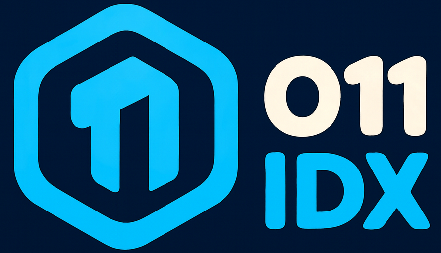
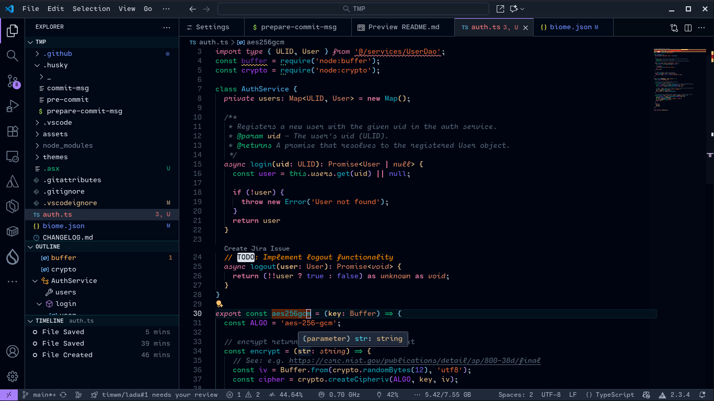
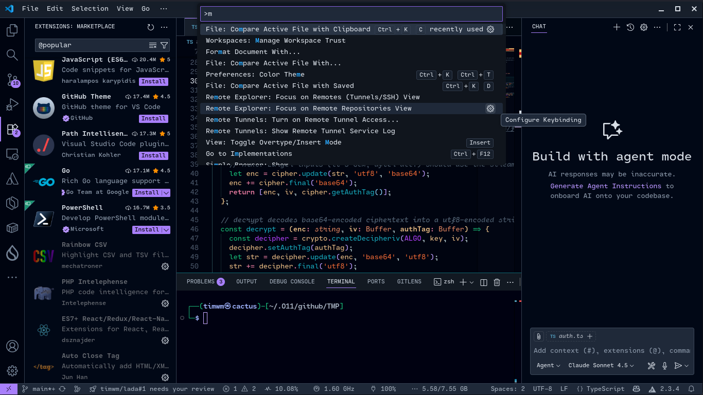

# O11 IDX Theme

<p align="center">
  
</p>

<p align="center">
  <strong>A beautiful theme for VS Code inspired by Google IDX</strong>
</p>

<p align="center">
  <!-- <a href="https://marketplace.visualstudio.com/items?itemName=timwm.o11-idx">
    
  </a> -->
  <!-- <a href="https://marketplace.visualstudio.com/items?itemName=timwm.o11-idx">
    
  </a> -->
</p>

<div align="center" style="text-align: center;">

[](https://marketplace.visualstudio.com/items?itemName=timwm.o11-idx)
[](https://marketplace.visualstudio.com/items?itemName=timwm.o11-idx)
[](https://open-vsx.org/extension/timwm/o11-idx)
<!-- [](https://marketplace.visualstudio.com/items?itemName=timwm.o11-idx) -->
<!-- [](https://open-vsx.org/extension/timwm/o11-idx) -->
[](https://github.com/timwm/o11-idx/actions/workflows/ci.yml)
[](https://github.com/timwm/o11-idx/blob/main/LICENSE)

</div>

<p align="center">Enjoying O11 IDX? Support the project by starring it or becoming a sponsor on <a href="https://github.com/sponsors/timwm">GitHub Sponsors</a>.</p>
<p align="center">
  <!-- Sponsor -->
  <!-- <a href="https://github.com/sponsors/timwm">
    
  </a> -->
  <a href="https://buymeacoffee.com/timwm">
    
  </a>
  <a href="https://github.com/timwm/o11-idx/stargazers">
    
  </a>
</p>

---

## ✨ Features

O11 IDX is a carefully crafted dark theme that brings the elegant aesthetics of Google IDX to your VS Code environment. Designed with developer comfort and productivity in mind, this theme offers:

### 🎨 **Beautiful Color Palette**

- **Deep, comfortable backgrounds** - Reduce eye strain during long coding sessions
- **Carefully selected syntax colors** - Enhanced code readability with distinct token colors
- **Soft, vibrant accents** - Purple, blue, and green highlights that pop without overwhelming

### 🔍 **Enhanced Readability**

- **High contrast where it matters** - Keywords, strings, and functions stand out clearly
- **Optimized bracket highlighting** - Easily track code blocks with color-coded brackets
- **Subtle UI elements** - Interface components that don't distract from your code

### 💡 **Smart Syntax Highlighting**

- **Multi-language support** - Consistent, beautiful colors across JavaScript, TypeScript, Python, HTML, CSS, C/C++, Haskell and more
- **Distinct token colors** - Keywords, strings, functions, variables, constants and types each have their own color
- **Markdown support** - Beautiful rendering for documentation

### 🎯 **Polished UI Elements**

- **Dark activity bar** - Clean, modern sidebar with purple accents
- **Elegant editor tabs** - Easy-to-read tabs with active state indicators
- **Refined status bar** - Subtle information display at the bottom
- **Consistent terminal colors** - ANSI colors that match the theme aesthetic

---

## 📸 Screenshots

### Editor View

<p align="center">
  
</p>

### Theme Preview

<p align="center">
  
</p>

---

## 🚀 Installation

### Via VS Code Marketplace

1. Open **Extensions** sidebar panel in VS Code (`Ctrl+Shift+X` / `Cmd+Shift+X`)
2. Search for **"O11 IDX"**
3. Click **Install**
4. Go to **File > Preferences > Theme > Color Theme** (or `Ctrl+K Ctrl+T` / `Cmd+K Cmd+T`)
5. Select **O11 IDX**

### Via Command Line

```bash
code --install-extension timwm.o11-idx
```

### Manual Installation

1. Download the `.vsix` file from [GitHub Releases](https://github.com/timwm/o11-idx/releases)
2. Open VS Code
3. Go to Extensions view
4. Click on the `...` menu at the top
5. Select **Install from VSIX...**
6. Choose the downloaded file

### Outside VS Code (npm)

The theme is also published to npm as strict JSON, for tools that load VS Code themes, such as [Shiki](https://shiki.style), and through Shiki the Monaco editor ([`@shikijs/monaco`](https://shiki.style/packages/monaco)):

```bash
npm install o11-idx
```

```js
import { createHighlighter } from "shiki";
import o11Idx from "o11-idx" with { type: "json" };

const highlighter = await createHighlighter({
  themes: [o11Idx],
  langs: ["ts"],
});
const html = highlighter.codeToHtml(code, { lang: "ts", theme: "O11 IDX" });
```

---

## 🎨 Color Palette

| Color                                                                       | Hex       | Usage                                              |
| --------------------------------------------------------------------------- | --------- | -------------------------------------------------- |
|  | `#000410` | Editor and activity bar background                 |
|  | `#010816` | Sidebar background                                 |
|  | `#d9dfe7` | Editor foreground, text                            |
|  | `#a87ffb` | Accent: active tab, activity bar, badges, buttons  |
|  | `#556677` | Comments                                           |
|  | `#df769b` | Keywords, operators                                |
|  | `#16b673` | Storage (`const`, `class`, `def`), HTML tags       |
|  | `#e66533` | Strings                                            |
|  | `#d5971a` | Template strings                                   |
|  | `#16a3b6` | Functions                                          |
|  | `#49d6e9` | Built-ins such as Python's `print`                 |
|  | `#e4b781` | Variables, properties                              |
|  | `#a83dee` | Constants, HTML attributes                         |
|  | `#7060eb` | Numbers, `true` / `null`                           |
|  | `#49ace9` | Class names                                        |
|  | `#d67e5c` | Types, interfaces, primitives (`string`, `number`) |
|  | `#85cdf1` | HTML attribute values                              |

---

## ⚙️ Configuration

### Recommended Font Settings

For the best experience with O11 IDX, I recommend these font settings:

```jsonc
{
  "editor.fontFamily": "'Cartograph CF', 'JetBrains Mono', 'Fira Code', Inconsolata, 'Source Code Pro Medium', 'Droid Sans Mono', monospace",
  "editor.fontLigatures": true
}
```

### Semantic Highlighting (optional)

Semantic highlighting colors names by what the language server knows about them across your project, not only by syntax. O11 IDX leaves it off by default, as its colors are tuned for syntax highlighting (tuning them for semantic tokens is tracked in [#13](https://github.com/timwm/o11-idx/issues/13)). To turn it on, add one of these to your `settings.json`:

```jsonc
{
  // For every theme
  "editor.semanticHighlighting.enabled": true,

  // Or only for O11 IDX
  "editor.semanticTokenColorCustomizations": {
    "[O11 IDX]": {
      "enabled": true,
      // Optional: color `const` like other variables
      "rules": { "variable.readonly": "#e4b781" }
    }
  }
}
```

---

## 🔧 Customization

You can customize the theme colors in your `settings.json`:

```jsonc
{
  "workbench.colorCustomizations": {
    "[O11 IDX]": {
      "editor.background": "#171f2b"
      // Add your custom colors here
    }
  },
  "editor.tokenColorCustomizations": {
    "[O11 IDX]": {
      "comments": "#7F8D9F"
      // Customize syntax colors here
    }
  }
  // ...
}
```

---

## 🤝 Contributing

We love contributions! Contributors are thanked automatically:

- When your pull request is merged, it gets a thank-you comment (with a welcome on your first one).
- When a release includes it, the pull request gets a comment linking that release.

`pnpm contributors:latest` lists everyone who contributed since the last release, with commit counts and GitHub avatars.

### How to Contribute

See [CONTRIBUTING.md](CONTRIBUTING.md) for setting up, testing the theme locally, commit conventions and how releases work. In short:

1. Fork the repository
2. Create your feature branch (`git checkout -b feature/amazing-feature`)
3. Commit your changes using conventional commits (`git commit -m 'feat: add amazing feature'`)
4. Push to the branch (`git push origin feature/amazing-feature`)
5. Open a Pull Request

Your contribution will be automatically recognized in the next release! 🎉

---

## 🐛 Issues & Suggestions

Found a bug or have a suggestion? Please open an issue on [GitHub Issues](https://github.com/timwm/o11-idx/issues).

---

## 📝 Changelog

See [CHANGELOG.md](CHANGELOG.md) for a detailed history of changes.

---

## 📄 License

This theme is licensed under the [GPL-2.0](LICENSE) license.

---

## 💖 Support

If you enjoy this theme, please consider:

- ⭐ [Starring the repository](https://github.com/timwm/o11-idx)
- 📢 Sharing it with others
- 🐛 Reporting bugs or suggesting improvements

---

## 🙏 Acknowledgments

- Inspired by **Google IDX**
- Built with love for the VS Code community

---

<p align="center">
  Made with ❤️ by <a href="https://github.com/timwm">timwm</a>
</p>

<p align="center">
  <strong>Happy Coding! 🚀</strong>
</p>
